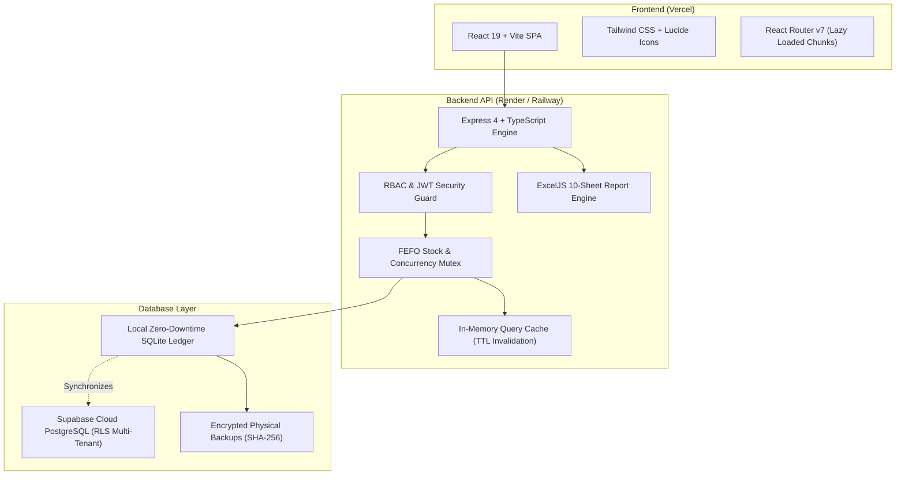

# 🥛 DairyTrack – Complete Dairy Shop Management & Analytics System

[](https://nodejs.org)
[](https://www.typescriptlang.org)
[](https://react.dev)
[](https://vitejs.dev)
[](https://tailwindcss.com)
[](https://supabase.com)
[](#-testing--quality-assurance)

**DairyTrack** is a production-grade, SaaS-ready business management platform built specifically for single and multi-branch dairy businesses, milk chilling centers, and dairy cooperatives. It coordinates inventory, FEFO batch allocation, rapid POS counter billing, supplier milk procurement, shelf-life monitoring, waste write-offs, customer Udhar ledgers, business intelligence, and automated multi-sheet Excel reports.

---

## 🌟 Key System Capabilities

- **⚡ Fast POS Billing**: Instant barcode & SKU search, dynamic discounts, multi-tender payments (Cash, UPI, Customer Credit/Udhar, Card, Split), and automatic receipt generation.
- **🥛 FEFO Batch Allocation**: First-Expired-First-Out automated deduction prevents selling expired dairy batches and enforces stock rotation.
- **🚨 Expiry & Spoilage Radar**: Visual real-time radar flags batches approaching 0-2 days remaining, enabling prompt clearance sales or discard write-offs.
- **📊 Business Intelligence & Margins**: Calculates true Net Sales, Cost of Goods Sold (COGS), Gross Profit, and Operating Profit deducting rent, electricity, cold-chain transport, and staff salaries.
- **📑 10-Sheet Master Excel Export**: One-click download of a professionally styled ExcelJS workbook formatted with green headers, INR currency, formulas, and auto-filters.
- **🔐 Enterprise Security & Reliability**: PBKDF2/SHA-512 password hashing, OWASP security headers, spreadsheet formula injection neutralization, idempotency keys, and SQLite/PostgreSQL stock triggers.
- **🗄️ Supabase PostgreSQL + Offline SQLite**: Dual-layer architecture provides zero-downtime offline counter billing synchronized with cloud multi-tenant PostgreSQL.

---

## 🏗️ System Architecture



---

## 📋 Comprehensive 20-Module Implementation

1. **Authentication & RBAC**: 3-tier role hierarchy (Administrator, Manager, Shopkeeper) with session tracking and password reset.
2. **Shop Dashboard**: Real-time sales velocity, live stock value, low-stock warnings, and payment breakdowns.
3. **Product Catalog**: SKU normalization, 11 dairy categories, shelf-life days, and storage temperature requirements.
4. **FEFO Inventory Ledger**: Auditable `inventory_movements` table prevents negative stock via database triggers.
5. **POS Counter Billing**: Multi-batch checkout, barcode lookup, thermal receipts, and duplicate invoice prevention.
6. **Procurement & Inward**: Supplier purchase orders, batch generation upon receipt, and milk quality verification.
7. **Stock Movements**: Inter-branch transfers, audit adjustments, and damage tracking.
8. **Supplier Management**: Milk supplier balances, payment settlements, and defect return logs.
9. **Customer & Udhar Ledger**: Monthly credit balances, credit limits, loyalty points, and payment receipts.
10. **Expiry Management**: Real-time 48-hour shelf-life warning radar and waste write-offs.
11. **Damaged Stock Recording**: Quantifies financial loss by batch and reasons.
12. **Analytics & BI**: Recharts visual graphs, top-selling products switchable by quantity/revenue/orders, and P&L analysis.
13. **Master Excel Reports**: 10-sheet complete workbook generated with ExcelJS.
14. **In-App Notification Center**: Unread alert engine for out-of-stock, expiry, and failed transactions.
15. **Supabase PostgreSQL Schema**: 20 normalized relational tables, UUID primary keys, and Row Level Security.
16. **TypeScript REST API**: Standardized endpoints with server-side validation, error handling, and rate limiting.
17. **React 19 Frontend**: 15 complete pages and 11 reusable UI components.
18. **Security & Reliability**: Concurrency mutex, SQL injection protection, CSP headers, and formula injection sanitization.
19. **QA & Testing**: 38 automated functional, edge case, and caching tests.
20. **Production Deployment**: Vercel frontend, Render/Railway backend, and Docker container support.

---

## 🚀 Quick Start Guide

### 1. Prerequisites
- Node.js `v20.x` or higher
- npm `v9.x` or higher

### 2. Clone and Install
```bash
git clone https://github.com/your-org/dairytrack.git
cd dairytrack
npm install
```

### 3. Configure Environment
```bash
cp .env.example .env
```

### 4. Build and Run
```bash
# Build TypeScript server and Vite frontend
npm run build:all

# Start application server
npm start
```

Access the app in your browser at **[http://localhost:3000](http://localhost:3000)**.

---

## 👥 Default Demo Credentials

| Role | Username / Email | Password | Access Scope |
| :--- | :--- | :--- | :--- |
| **👑 Administrator** | `admin` or `admin@dairytrack.com` | `admin123` | Complete system control, users, backups |
| **📋 Store Manager** | `manager` or `manager@dairytrack.com` | `manager123` | Stock, purchases, sales, analytics, reports |
| **🏷️ Cashier / Staff** | `shopkeeper` or `shopkeeper@dairytrack.com` | `staff123` | POS billing, stock lookup, Udhar collection |

*(Quick demo login buttons are also accessible on the login modal to switch roles seamlessly).*

---

## 🧪 Testing & Quality Assurance

Run the comprehensive QA test suite (38 functional, edge case, and caching tests):

```bash
npm run test:qa
```

Run security and backend architecture tests:
```bash
node scratch/test_module18.js   # 50/50 Security tests
node scratch/test_module17.js   # 62/62 Frontend structure checks
node scratch/test_module16.js   # 90/90 Backend REST tests
node scratch/test_module15.js   # 114/114 Supabase schema tests
```

---

## 🌐 Production Deployment

- **Frontend Deployment (Vercel)**: Follow [INSTALLATION.md](file:///c:/Users/CHAKRI/OneDrive/Desktop/Web%20Programs/DiaryTrack/INSTALLATION.md#4-frontend-deployment-on-vercel)
- **Backend Deployment (Render / Railway)**: Follow [INSTALLATION.md](file:///c:/Users/CHAKRI/OneDrive/Desktop/Web%20Programs/DiaryTrack/INSTALLATION.md#5-backend-deployment-on-render--railway)
- **Database Migrations (Supabase)**: Run `npm run migrate` or execute SQL in `supabase/migrations/`
- **Docker Deployment**: Run `docker build -t dairytrack . && docker run -p 3000:3000 dairytrack`

---

## 📚 Documentation Reference

- **[Installation Guide](file:///c:/Users/CHAKRI/OneDrive/Desktop/Web%20Programs/DiaryTrack/INSTALLATION.md)**: Detailed step-by-step setup for local, Docker, Supabase, Vercel, and Render.
- **[Database Schema](file:///c:/Users/CHAKRI/OneDrive/Desktop/Web%20Programs/DiaryTrack/docs/DATABASE_SCHEMA.md)**: Full architecture of all 20 Supabase PostgreSQL tables and RLS policies.
- **[REST API Reference](file:///c:/Users/CHAKRI/OneDrive/Desktop/Web%20Programs/DiaryTrack/docs/API_DOCUMENTATION.md)**: Request/response payloads, endpoints, and error handling.
- **[Operational User Guide](file:///c:/Users/CHAKRI/OneDrive/Desktop/Web%20Programs/DiaryTrack/docs/USER_GUIDE.md)**: Operational manuals for Cashiers, Store Managers, and Shop Owners.

---

## 📄 License
This project is licensed under the MIT License - see the LICENSE file for details.
