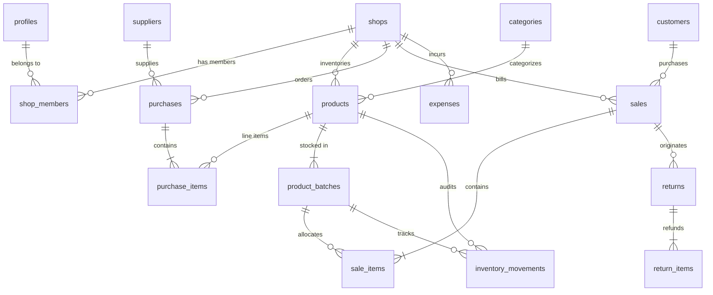

# 🗄️ DairyTrack Database Architecture & Relational Schema

DairyTrack uses **Supabase PostgreSQL** as its primary cloud relational database, coupled with a high-performance local SQLite storage engine for resilient zero-downtime offline capabilities.

The database is fully normalized (3NF), utilizes UUID v4 primary keys, enforces strict foreign-key referential integrity, implements check constraints for data validity, and secures every table via **Row Level Security (RLS)** for multi-tenant shop isolation.

---

## 📐 Entity Relationship Architecture



---

## 📋 The 20 Normalized Relational Tables

### 1. `profiles`
User profiles synchronized with Supabase Auth (`auth.users`).
- **Columns**:
  - `id` (UUID, PK) -> References `auth.users(id)`
  - `email` (TEXT, UNIQUE, NOT NULL)
  - `full_name` (TEXT, NOT NULL)
  - `phone` (TEXT)
  - `avatar_url` (TEXT)
  - `role` (TEXT, NOT NULL, DEFAULT `'Shopkeeper'`) -> CHECK (`'Administrator'`, `'Manager'`, `'Shopkeeper'`)
  - `is_active` (BOOLEAN, DEFAULT `true`)
  - `created_at`, `updated_at` (TIMESTAMPTZ)
- **RLS**: Users can read/update their own profile; Administrators have full tenant management.

---

### 2. `shops`
Dairy shop units, central distribution centers, and retail branch locations.
- **Columns**:
  - `id` (UUID, PK, DEFAULT `gen_random_uuid()`)
  - `name` (TEXT, NOT NULL)
  - `legal_name`, `gstin`, `fssai_license` (TEXT)
  - `phone` (TEXT, NOT NULL), `email`, `address`, `city`, `state`, `postal_code` (TEXT)
  - `upi_vpa` (TEXT)
  - `tax_rate_percent` (NUMERIC(5,2), DEFAULT `5.00`)
  - `is_main_branch` (BOOLEAN, DEFAULT `false`)
  - `is_active` (BOOLEAN, DEFAULT `true`)
  - `created_by` (UUID) -> References `profiles(id)`
  - `created_at`, `updated_at` (TIMESTAMPTZ)

---

### 3. `shop_members`
Junction table linking staff profiles to specific dairy shop branches with scoped permissions.
- **Columns**:
  - `id` (UUID, PK)
  - `shop_id` (UUID, NOT NULL) -> References `shops(id)` ON DELETE CASCADE
  - `profile_id` (UUID, NOT NULL) -> References `profiles(id)` ON DELETE CASCADE
  - `role` (TEXT, NOT NULL) -> CHECK (`'Owner'`, `'Manager'`, `'Cashier'`, `'Staff'`)
  - `is_primary_branch` (BOOLEAN, DEFAULT `true`)
  - `created_at` (TIMESTAMPTZ)
- **Constraint**: `UNIQUE(shop_id, profile_id)`

---

### 4. `categories`
Hierarchical classification of dairy items (Milk, Curd, Paneer, Ghee, Butter, Ice Cream, etc.).
- **Columns**:
  - `id` (UUID, PK)
  - `shop_id` (UUID) -> References `shops(id)`
  - `name` (TEXT, NOT NULL)
  - `description` (TEXT)
  - `icon` (TEXT, DEFAULT `'box'`)
  - `display_order` (INTEGER, DEFAULT `0`)
  - `is_active` (BOOLEAN, DEFAULT `true`)
  - `created_at`, `updated_at` (TIMESTAMPTZ)

---

### 5. `products`
Master catalog of dairy products with SKU, barcode, unit of measure, pricing, and reorder levels.
- **Columns**:
  - `id` (UUID, PK)
  - `shop_id` (UUID, NOT NULL) -> References `shops(id)`
  - `category_id` (UUID, NOT NULL) -> References `categories(id)`
  - `supplier_id` (UUID) -> References `suppliers(id)`
  - `name` (TEXT, NOT NULL)
  - `sku` (TEXT, NOT NULL, UNIQUE)
  - `barcode` (TEXT)
  - `unit` (TEXT, NOT NULL) -> CHECK (`'L'`, `'ml'`, `'kg'`, `'g'`, `'pkt'`, `'tin'`, `'can'`)
  - `purchase_price` (NUMERIC(12,2), NOT NULL, CHECK `>= 0.00`)
  - `selling_price` (NUMERIC(12,2), NOT NULL, CHECK `>= 0.00`)
  - `min_stock_level` (NUMERIC(12,3), DEFAULT `10.000`)
  - `shelf_life_days` (INTEGER, DEFAULT `3`)
  - `storage_temperature` (TEXT, DEFAULT `'2°C - 4°C'`)
  - `is_active` (BOOLEAN, DEFAULT `true`)
  - `created_at`, `updated_at` (TIMESTAMPTZ)

---

### 6. `suppliers`
Milk producers, local dairy farmers, cooperatives, and commercial packing vendors.
- **Columns**:
  - `id` (UUID, PK)
  - `shop_id` (UUID, NOT NULL) -> References `shops(id)`
  - `name` (TEXT, NOT NULL)
  - `contact_person`, `phone`, `email`, `address`, `gst_number` (TEXT)
  - `payment_terms` (TEXT, DEFAULT `'Weekly'`)
  - `balance_due` (NUMERIC(12,2), DEFAULT `0.00`)
  - `is_active` (BOOLEAN, DEFAULT `true`)
  - `created_at`, `updated_at` (TIMESTAMPTZ)

---

### 7. `customers`
Retail walk-in patrons and registered wholesale/monthly credit (Udhar) clients.
- **Columns**:
  - `id` (UUID, PK)
  - `shop_id` (UUID, NOT NULL) -> References `shops(id)`
  - `name` (TEXT, NOT NULL)
  - `phone` (TEXT, NOT NULL)
  - `email`, `address` (TEXT)
  - `credit_limit` (NUMERIC(12,2), DEFAULT `0.00`)
  - `credit_balance` (NUMERIC(12,2), DEFAULT `0.00`)
  - `loyalty_points` (INTEGER, DEFAULT `0`)
  - `created_at`, `updated_at` (TIMESTAMPTZ)

---

### 8. `product_batches`
Inventory batches tracking manufacturing dates, shelf-life, and First-Expired-First-Out (FEFO) order.
- **Columns**:
  - `id` (UUID, PK)
  - `product_id` (UUID, NOT NULL) -> References `products(id)`
  - `shop_id` (UUID, NOT NULL) -> References `shops(id)`
  - `batch_number` (TEXT, NOT NULL)
  - `mfg_date` (DATE NOT NULL)
  - `expiry_date` (DATE NOT NULL)
  - `initial_quantity` (NUMERIC(12,3), NOT NULL)
  - `current_quantity` (NUMERIC(12,3), NOT NULL, CHECK `>= 0.000`)
  - `purchase_cost` (NUMERIC(12,2), NOT NULL)
  - `selling_price` (NUMERIC(12,2), NOT NULL)
  - `status` (TEXT, DEFAULT `'Active'`) -> CHECK (`'Active'`, `'Depleted'`, `'Expired'`, `'Quarantine'`)
  - `created_at`, `updated_at` (TIMESTAMPTZ)
- **Constraint**: `UNIQUE(product_id, batch_number, shop_id)`

---

### 9. `purchases`
Inward procurement orders for raw milk and packaged dairy supplies.
- **Columns**:
  - `id` (UUID, PK)
  - `invoice_no` (TEXT, NOT NULL, UNIQUE)
  - `shop_id` (UUID, NOT NULL) -> References `shops(id)`
  - `supplier_id` (UUID, NOT NULL) -> References `suppliers(id)`
  - `purchase_date` (DATE NOT NULL)
  - `total_amount` (NUMERIC(12,2), NOT NULL)
  - `tax_amount`, `discount_amount`, `net_amount` (NUMERIC(12,2))
  - `payment_status` (TEXT, DEFAULT `'Unpaid'`) -> CHECK (`'Paid'`, `'Partial'`, `'Unpaid'`)
  - `payment_method` (TEXT, DEFAULT `'Bank Transfer'`)
  - `status` (TEXT, DEFAULT `'Draft'`) -> CHECK (`'Draft'`, `'Received'`, `'Cancelled'`)
  - `received_at` (TIMESTAMPTZ), `received_by` (UUID)
  - `created_at`, `updated_at` (TIMESTAMPTZ)

---

### 10. `purchase_items`
Individual line items within a procurement invoice, linked to created product batches.
- **Columns**:
  - `id` (UUID, PK)
  - `purchase_id` (UUID, NOT NULL) -> References `purchases(id)` ON DELETE CASCADE
  - `product_id` (UUID, NOT NULL) -> References `products(id)`
  - `batch_id` (UUID) -> References `product_batches(id)`
  - `batch_number`, `mfg_date`, `expiry_date` (TEXT / DATE)
  - `quantity` (NUMERIC(12,3), NOT NULL, CHECK `> 0`)
  - `unit_cost` (NUMERIC(12,2), NOT NULL)
  - `total_cost` (NUMERIC(12,2), NOT NULL)
  - `created_at` (TIMESTAMPTZ)

---

### 11. `sales`
Completed POS sales transactions and customer billing records.
- **Columns**:
  - `id` (UUID, PK)
  - `invoice_no` (TEXT, NOT NULL, UNIQUE)
  - `shop_id` (UUID, NOT NULL) -> References `shops(id)`
  - `customer_id` (UUID) -> References `customers(id)`
  - `sale_date` (DATE NOT NULL)
  - `subtotal`, `tax_amount`, `discount_amount`, `net_amount` (NUMERIC(12,2), NOT NULL)
  - `total_cost` (NUMERIC(12,2), NOT NULL) -> Cost of Goods Sold
  - `profit_earned` (NUMERIC(12,2), NOT NULL) -> Net Sales - COGS
  - `payment_method` (TEXT, NOT NULL) -> (`'Cash'`, `'UPI'`, `'Card'`, `'Customer Credit'`, `'Split'`)
  - `payment_status` (TEXT, DEFAULT `'Paid'`)
  - `cashier_id` (UUID) -> References `profiles(id)`
  - `created_at` (TIMESTAMPTZ)

---

### 12. `sale_items`
Line items for each sale with exact batch allocations and profit calculation.
- **Columns**:
  - `id` (UUID, PK)
  - `sale_id` (UUID, NOT NULL) -> References `sales(id)` ON DELETE CASCADE
  - `product_id` (UUID, NOT NULL) -> References `products(id)`
  - `batch_id` (UUID, NOT NULL) -> References `product_batches(id)`
  - `quantity` (NUMERIC(12,3), NOT NULL, CHECK `> 0`)
  - `unit_price`, `unit_cost`, `total_price`, `profit` (NUMERIC(12,2), NOT NULL)
  - `created_at` (TIMESTAMPTZ)

---

### 13. `payments`
Granular financial ledger tracking incoming customer payments and outgoing supplier disbursements.
- **Columns**:
  - `id` (UUID, PK)
  - `shop_id` (UUID, NOT NULL) -> References `shops(id)`
  - `payment_number` (TEXT, NOT NULL, UNIQUE)
  - `payment_type` (TEXT, NOT NULL) -> CHECK (`'Customer Sale'`, `'Customer Udhar Settlement'`, `'Supplier Payment'`, `'Customer Refund'`)
  - `amount` (NUMERIC(12,2), NOT NULL, CHECK `> 0`)
  - `payment_method` (TEXT, NOT NULL)
  - `reference_no` (TEXT)
  - `customer_id` (UUID) -> References `customers(id)`
  - `supplier_id` (UUID) -> References `suppliers(id)`
  - `sale_id` (UUID) -> References `sales(id)`
  - `purchase_id` (UUID) -> References `purchases(id)`
  - `payment_date` (DATE NOT NULL)
  - `created_at` (TIMESTAMPTZ)

---

### 14. `inventory_movements`
The **immutable, append-only auditable source of truth** for all stock movements.
- **Columns**:
  - `id` (UUID, PK)
  - `shop_id` (UUID, NOT NULL) -> References `shops(id)`
  - `product_id` (UUID, NOT NULL) -> References `products(id)`
  - `batch_id` (UUID, NOT NULL) -> References `product_batches(id)`
  - `movement_type` (TEXT, NOT NULL) -> CHECK (`'Purchase Inward'`, `'Sale'`, `'Customer Return'`, `'Supplier Return'`, `'Spoilage/Damage'`, `'Expired'`, `'Internal Transfer Out'`, `'Internal Transfer In'`, `'Opening Balance'`, `'Audit Adjustment'`)
  - `quantity` (NUMERIC(12,3), NOT NULL, CHECK `quantity != 0`)
  - `cost_impact` (NUMERIC(12,2), NOT NULL)
  - `reason` (TEXT, NOT NULL)
  - `reference_id` (UUID)
  - `performed_by` (UUID) -> References `profiles(id)`
  - `movement_date` (TIMESTAMPTZ NOT NULL DEFAULT now())
  - `created_at` (TIMESTAMPTZ NOT NULL DEFAULT now())
- **Constraint**: Strict trigger prevents any UPDATE or DELETE operations on this table.

---

### 15. `stock_transfers`
Inter-branch transfers of dairy stock between shop locations.
- **Columns**:
  - `id` (UUID, PK)
  - `transfer_number` (TEXT, NOT NULL, UNIQUE)
  - `from_shop_id` (UUID, NOT NULL) -> References `shops(id)`
  - `to_shop_id` (UUID, NOT NULL) -> References `shops(id)`
  - `product_id` (UUID, NOT NULL) -> References `products(id)`
  - `batch_id` (UUID, NOT NULL) -> References `product_batches(id)`
  - `quantity` (NUMERIC(12,3), NOT NULL, CHECK `> 0`)
  - `status` (TEXT, DEFAULT `'Pending'`) -> CHECK (`'Pending'`, `'In Transit'`, `'Received'`, `'Rejected'`)
  - `dispatched_at`, `received_at` (TIMESTAMPTZ)
  - `created_at` (TIMESTAMPTZ)
- **Constraint**: `CHECK (from_shop_id != to_shop_id)`

---

### 16. `returns`
Master header for customer return merchandise authorizations.
- **Columns**:
  - `id` (UUID, PK)
  - `return_number` (TEXT, NOT NULL, UNIQUE)
  - `shop_id` (UUID, NOT NULL) -> References `shops(id)`
  - `sale_id` (UUID, NOT NULL) -> References `sales(id)`
  - `customer_id` (UUID) -> References `customers(id)`
  - `total_refund_amount` (NUMERIC(12,2), NOT NULL)
  - `refund_method` (TEXT, NOT NULL)
  - `reason` (TEXT, NOT NULL)
  - `processed_by` (UUID) -> References `profiles(id)`
  - `created_at` (TIMESTAMPTZ)

---

### 17. `return_items`
Individual items returned by customers, indicating restock vs disposal status.
- **Columns**:
  - `id` (UUID, PK)
  - `return_id` (UUID, NOT NULL) -> References `returns(id)` ON DELETE CASCADE
  - `product_id` (UUID, NOT NULL) -> References `products(id)`
  - `batch_id` (UUID, NOT NULL) -> References `product_batches(id)`
  - `quantity` (NUMERIC(12,3), NOT NULL, CHECK `> 0`)
  - `refund_amount` (NUMERIC(12,2), NOT NULL)
  - `restocked` (BOOLEAN NOT NULL DEFAULT true)
  - `created_at` (TIMESTAMPTZ)

---

### 18. `expenses`
Operational overhead expenses (Rent, Electricity, Cold Chain Transport, Salaries, Cleaning).
- **Columns**:
  - `id` (UUID, PK)
  - `shop_id` (UUID, NOT NULL) -> References `shops(id)`
  - `expense_date` (DATE NOT NULL)
  - `category` (TEXT, NOT NULL) -> CHECK (`'Rent'`, `'Electricity'`, `'Transport'`, `'Salaries'`, `'Packaging'`, `'Maintenance'`, `'Other'`)
  - `title` (TEXT, NOT NULL)
  - `amount` (NUMERIC(12,2), NOT NULL, CHECK `> 0`)
  - `payment_mode` (TEXT, DEFAULT `'Bank Transfer'`)
  - `reference_no`, `notes` (TEXT)
  - `recorded_by` (UUID) -> References `profiles(id)`
  - `created_at` (TIMESTAMPTZ)

---

### 19. `notifications`
Real-time alert messages for low stock, expiry warnings, failed checkouts, and procurement arrivals.
- **Columns**:
  - `id` (UUID, PK)
  - `shop_id` (UUID) -> References `shops(id)`
  - `recipient_id` (UUID) -> References `profiles(id)`
  - `type` (TEXT, NOT NULL) -> (`'low_stock'`, `'near_expiry'`, `'expired'`, `'unusual_adjustment'`, `'purchase_new'`, `'sale_complete'`, `'transaction_failed'`, `'system'`)
  - `title` (TEXT, NOT NULL)
  - `message` (TEXT, NOT NULL)
  - `severity` (TEXT, DEFAULT `'info'`) -> CHECK (`'info'`, `'success'`, `'warning'`, `'danger'`)
  - `is_read` (BOOLEAN, DEFAULT `false`)
  - `link_view` (TEXT)
  - `created_at` (TIMESTAMPTZ)

---

### 20. `audit_logs`
Cryptographic, security-hardened operational trail recording all administrative actions.
- **Columns**:
  - `id` (UUID, PK)
  - `shop_id` (UUID) -> References `shops(id)`
  - `user_id` (UUID) -> References `profiles(id)`
  - `user_name` (TEXT, NOT NULL)
  - `user_role` (TEXT, NOT NULL)
  - `action` (TEXT, NOT NULL)
  - `entity_type` (TEXT, NOT NULL)
  - `entity_id` (TEXT)
  - `details` (TEXT NOT NULL)
  - `ip_address` (TEXT)
  - `created_at` (TIMESTAMPTZ DEFAULT now())

---

## 🔒 Row Level Security (RLS) Policies

All 20 tables have `ROW LEVEL SECURITY` enabled.

Multi-tenant isolation helper functions:
```sql
CREATE OR REPLACE FUNCTION get_auth_shop_ids()
RETURNS SETOF UUID AS $$
  SELECT shop_id FROM public.shop_members WHERE profile_id = auth.uid();
$$ LANGUAGE sql SECURITY DEFINER;
```

Policies enforce:
1. Staff members can only query and mutate data belonging to their assigned `shop_id`.
2. Super-administrators can view across multi-branch networks.
3. Cashiers cannot modify product master prices, execute supplier payments, or purge audit records.
